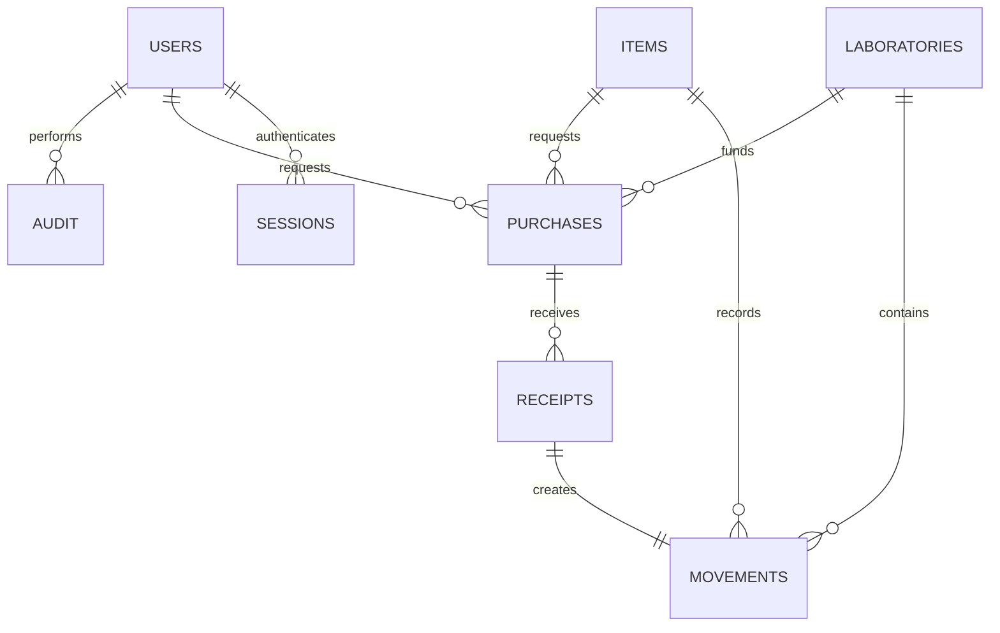

# Local architecture
Next.js App Router + React/TypeScript; Node server route boundary; PostgreSQL 17; pg connection pool; bcrypt password hashes; random opaque sessions hashed at rest, HttpOnly/SameSite cookies, origin checks. No browser-local business data. Application runtime uses a restricted database role and PostgreSQL row-level security with transaction-local authenticated user context. Table owner is only used for migrations/seed. No public deployment or university integration.

Tables: users (role and lab assignments); sessions; laboratories (JSON profile with facilities/personnel, archived); items (asset ID, type, serial/warranty/location, acquisition cost); immutable movements (source/destination lab, quantity, type, actor, reference, checkout relationship); purchases (request/approval/order/partial receipt state and cost/funding/vendor); receipts (unique idempotency key); immutable audit. Inventory balance derives exclusively from movements. Durable items may have quantity >1 only when not serialized; serialized assets have one unit. Transfers post atomic paired ledger rows. Checkout returns reference the original checkout, so outstanding amounts cannot be exceeded. Purchase receiving locks the order, rejects overreceipt, and creates ledger entries in the same transaction, with a unique receipt key preventing duplicates.

System/School Administrators manage all labs, user provisioning and purchase approvals. Managers manage assigned labs and place approved orders. Assistants transact assigned labs and request purchases; Faculty/Staff read active records and request purchases. No self approval. Archive preserves audit/history. Server validates every command; RLS constrains database visibility/writes to scoped labs and roles. Database triggers reject immutable history edits, insufficient stock, unauthenticated actors and inappropriate purchase transitions. Runtime database credentials must never be shared with users.

Current inventory is a snapshot, not a historical valuation. Acquisition value is an estimate from recorded unit costs. Received expenditure is actual recorded receipts, still unreconciled with institutional finance. Period reports filter transaction and receipt dates; current inventory/facility snapshots remain explicitly labeled. Semester/academic/fiscal definitions are configurable and require institutional validation.

## Relationships

Profile JSON fields: campus, building, room, sqft, approved, functional, stations, operational, manager, managerEmail, managerContact, assistant, assistantEmail, assistantContact, personnel, description, categories, notes, verified. Null capacity/area denotes missing data. Item details hold location, serial, warranty, reorder and notes. Purchase details hold vendor, vendorContact, funding, justification and PO reference. UUID primary keys identify laboratories and assets independently of mutable human-readable names/SKUs. Numeric costs use PostgreSQL numeric(14,2). Timestamps use timestamptz; stored events are immutable.

Migrations: 001 establishes tables, RLS, transaction guards and audit; 002 adds serialized asset validation, constrained lab scope and paired transfer reconciliation; 003 enforces receipt/order reconciliation and physical serialized counts including outstanding checkouts. PostgreSQL locking serializes concurrent stock changes. Database owner credentials are never used by application requests.
